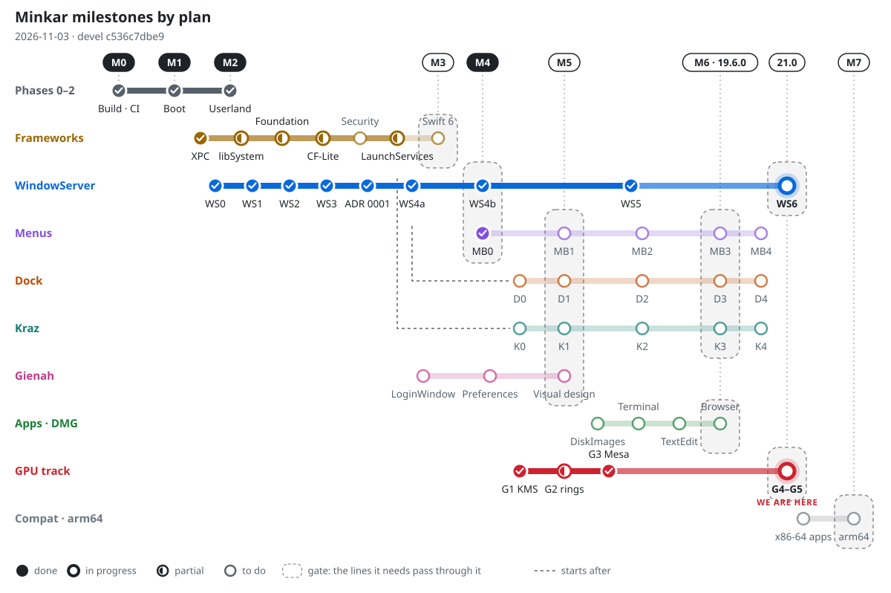
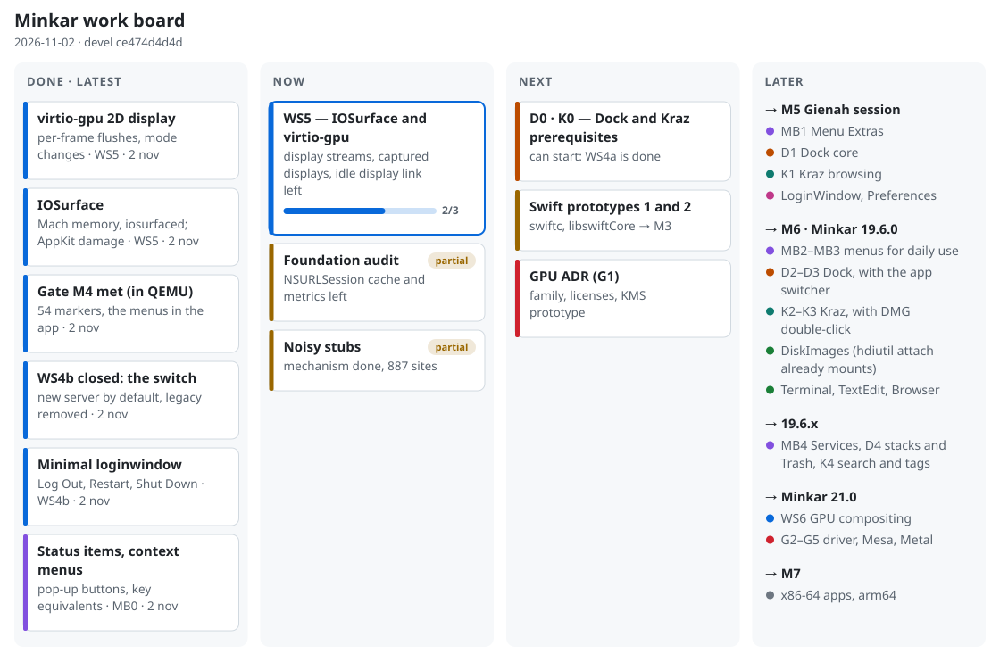

# Minkar — El avance de un vistazo

Esta página se genera desde [progress/status.toml](progress/status.toml) con
`bmake progress`; [ROADMAP.md](ROADMAP.md) (en inglés) es la fuente de verdad, y
[ROADMAP.es.md](ROADMAP.es.md) su versión en español. En inglés:
[Progress.md](Progress.md).

<!-- progress:summary:begin -->
_Actualizado el 2026-11-05, devel `22a0e67f0d`_

| Plan | Avance |  | Ahora | Siguiente |
| --- | --- | --- | --- | --- |
| **Gates** | 🟩🟩🟩🟩🟩⬜⬜⬜⬜ | 5 / 9 | — | M5 Atlas desktop |
| [Phases 0–2](ROADMAP.es.md) | 🟩🟩🟩 | 3 / 3 | — | — |
| [Frameworks](ROADMAP.es.md#fase-3--frameworks-base-y-swift) | 🟩🟨🟨🟨⬜🟩🟨🟩🟦 | 3 / 9 | Cocoa coverage | Security |
| [WindowServer](WindowServer-Rewrite.es.md) | 🟩🟩🟩🟩🟩🟩🟩🟩🟦 | 8 / 9 | WS6 | — |
| [Menus](Atlas.es.md#3-menús) | 🟩🟨⬜⬜⬜ | 1 / 5 | MB1 | MB2 |
| [Dock](Atlas.es.md#4-dock-y-files) | 🟩🟩🟨⬜⬜ | 2 / 5 | D2 | D3 |
| [Files](Atlas.es.md#4-dock-y-files) | 🟨🟩⬜⬜⬜ | 1 / 5 | K0 | K2 |
| [Atlas](ROADMAP.es.md#fase-5--escritorio-atlas) | ⬜🟨⬜ | 0 / 3 | Preferences | LoginWindow |
| [Apps · DMG](Atlas.es.md#5-aplicaciones) | ⬜⬜🟨⬜ | 0 / 4 | A2 Text Editor | A0 base |
| [GPU track](ROADMAP.es.md#pila-gráfica-componentes-y-secuencia) | 🟩🟨🟩🟦 | 2 / 4 | G4–G5 | — |
| [Compat · arm64](ROADMAP.es.md#fase-7--compatibilidad-binaria-y-arm64) | ⬜⬜ | 0 / 2 | — | x86-64 apps |

🟩 hecho · 🟦 en curso · 🟨 parcial · ⬜ por hacer
<!-- progress:summary:end -->

## Hitos por plan

<picture>
  <source media="(prefers-color-scheme: dark)" srcset="progress/metro-dark.svg">
  
</picture>

Planes: [ROADMAP.es.md](ROADMAP.es.md) · [WindowServer-Rewrite.es.md](WindowServer-Rewrite.es.md) ·
[Atlas.es.md](Atlas.es.md)

## Tablero de trabajo

<picture>
  <source media="(prefers-color-scheme: dark)" srcset="progress/board-dark.svg">
  
</picture>
