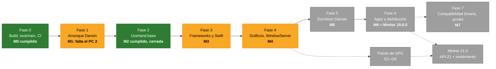
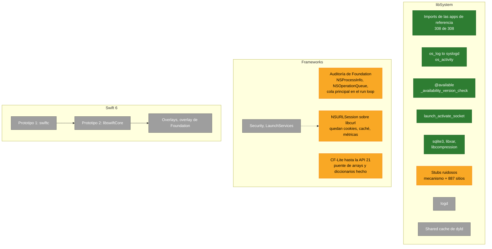
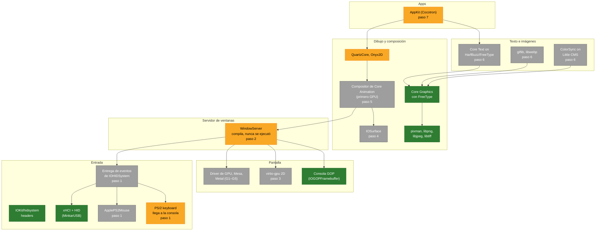
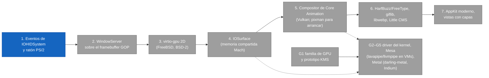

# Minkar — El avance de un vistazo

El estado del roadmap en diagramas; [ROADMAP.es.md](ROADMAP.es.md) lo describe y
[ROADMAP.md](ROADMAP.md) (en inglés) es la fuente de verdad. Cada cambio allí se
refleja aquí. En inglés: [Progress.md](Progress.md). Actualizado el 31 oct 2026.

Colores: verde hecho, amarillo parcial o en curso, gris sin empezar.

## Ruta crítica y gates

## Fase 3: libSystem y Foundation

## Pila gráfica: componentes por estado

Cada caja indica el paso de la secuencia (abajo) que la cierra.

## Pila gráfica: secuencia de desarrollo

El paso 1 es el siguiente (azul): sin entrada, WindowServer no puede cerrar M4. G1
empieza en cuanto se decida la familia de GPU; las flechas discontinuas marcan lo
que el frente de GPU reutiliza de los pasos 4 y 5.
