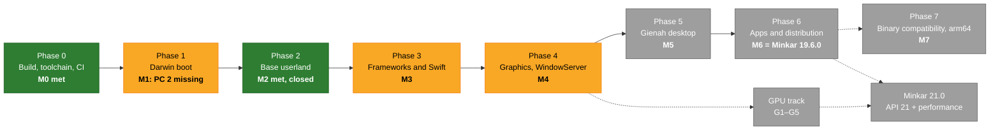
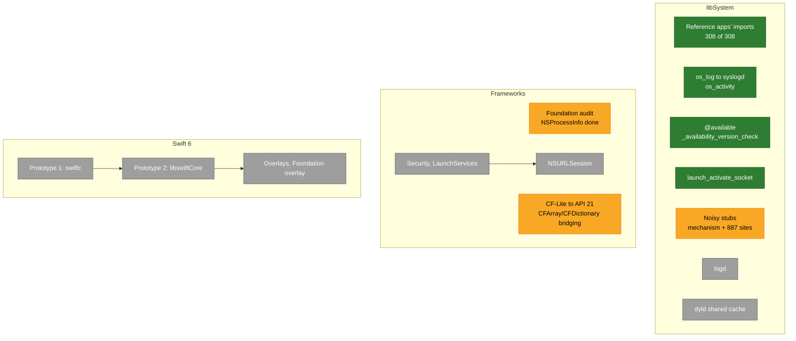
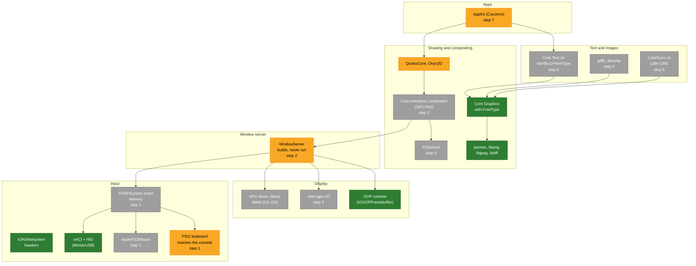
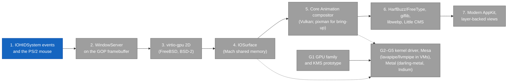

# Minkar — Progress at a glance

The roadmap's state as diagrams; [ROADMAP.md](ROADMAP.md) is the source of
truth and every change there is mirrored here. Spanish:
[Progress.es.md](Progress.es.md). Last updated 2026-10-31.

Colours: green done, yellow partial or in progress, grey not started.

## Critical path and gates

## Phase 3: libSystem and Foundation

## Graphics stack: components by state

Each box says the sequence step (below) that closes it.

## Graphics stack: development sequence

Step 1 is next (blue): without input, WindowServer cannot close M4. G1 starts
as soon as the GPU family is decided; the dashed arrows mark what the GPU
track reuses from steps 4 and 5.
