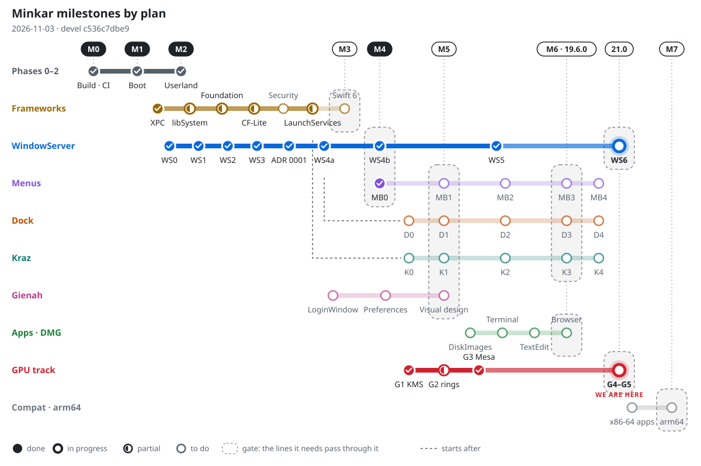
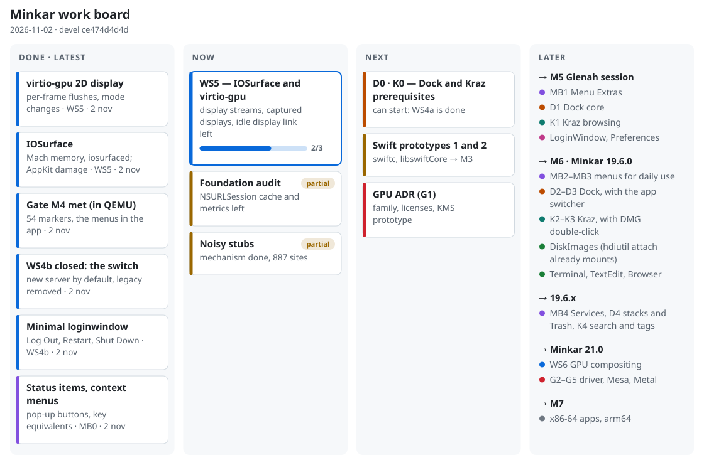

# Minkar — Progress at a glance

This page is generated from [progress/status.toml](progress/status.toml) by
`bmake progress`; [ROADMAP.md](ROADMAP.md) is the source of truth. Spanish:
[Progress.es.md](Progress.es.md).

<!-- progress:summary:begin -->
_Updated 2026-11-03, devel `2f0c5038af`_

| Plan | Progress |  | Now | Next |
| --- | --- | --- | --- | --- |
| **Gates** | 🟩🟩🟩⬜🟩⬜⬜⬜⬜ | 4 / 9 | — | M3 Frameworks and Swift |
| [Phases 0–2](ROADMAP.md) | 🟩🟩🟩 | 3 / 3 | — | — |
| [Frameworks](ROADMAP.md#phase-3--base-frameworks-and-swift) | 🟩🟨🟨🟨⬜🟨⬜ | 1 / 7 | libSystem, Foundation, CF-Lite, LaunchServices | Security |
| [WindowServer](WindowServer-Rewrite.md) | 🟩🟩🟩🟩🟩🟩🟩🟩🟦 | 8 / 9 | WS6 | — |
| [Menus](Menus.md) | 🟩⬜⬜⬜⬜ | 1 / 5 | — | MB1 |
| [Dock](Dock-Kraz.md) | ⬜⬜⬜⬜⬜ | 0 / 5 | — | D0 |
| [Kraz](Dock-Kraz.md) | ⬜⬜⬜⬜⬜ | 0 / 5 | — | K0 |
| [Gienah](ROADMAP.md#phase-5--gienah-desktop) | ⬜⬜⬜ | 0 / 3 | — | LoginWindow |
| [Apps · DMG](ROADMAP.md#phase-6--applications-and-distribution) | ⬜⬜⬜⬜ | 0 / 4 | — | DiskImages |
| [GPU track](ROADMAP.md#graphics-stack-components-and-sequence) | 🟩🟨🟩🟦 | 2 / 4 | G4–G5 | — |
| [Compat · arm64](ROADMAP.md#phase-7--binary-compatibility-and-arm64) | ⬜⬜ | 0 / 2 | — | x86-64 apps |

🟩 done · 🟦 in progress · 🟨 partial · ⬜ to do
<!-- progress:summary:end -->

## Milestones by plan

<picture>
  <source media="(prefers-color-scheme: dark)" srcset="progress/metro-dark.svg">
  
</picture>

Plans: [ROADMAP.md](ROADMAP.md) · [WindowServer-Rewrite.md](WindowServer-Rewrite.md) ·
[Menus.md](Menus.md) · [Dock-Kraz.md](Dock-Kraz.md)

## Work board

<picture>
  <source media="(prefers-color-scheme: dark)" srcset="progress/board-dark.svg">
  
</picture>
